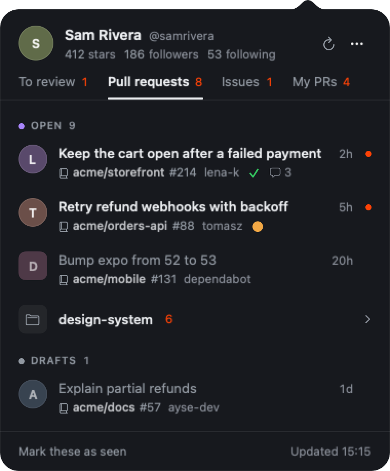

<p align="center">
  
</p>

<h1 align="center">Dev+ Bar</h1>

<p align="center">
  Pull requests and issues people open on your GitHub repositories, in the macOS menu bar.
</p>

<p align="center">
  
</p>

<p align="center">
  
</p>

## Install

```sh
curl -fsSL https://devplusbar.pages.dev/install.sh | sh
```

Or with Homebrew:

```sh
brew install --cask therbta/tap/devplusbar
```

Or download a packaged release from your internal distribution source and move
Dev+ Bar to Applications.

Needs macOS 14 or newer. The app is signed and notarized by Apple.

## Use

Open Dev+ Bar and sign in with GitHub. If the [GitHub CLI](https://cli.github.com) is signed in,
you can continue as that account instead.

Click the icon in the menu bar. The panel shows pull requests waiting for your review, pull
requests and issues other people opened on your repositories, issues assigned to you, and your
own open pull requests.
Green marks what you haven't seen yet.

| Key | |
| --- | --- |
| ↑ ↓, Return | Move between rows, open one on GitHub |
| ← → | Switch tabs |
| ⌘R | Refresh |
| ⌘, | Settings: organizations, hidden repositories, notifications, launch at login |

Dev+ Bar talks only to GitHub, with your own token, kept in the macOS Keychain. It has no server
and no analytics.

## Update or remove

Run the install command again to update, or `brew upgrade --cask devplusbar`.
To remove Dev+ Bar, quit it and move it to the Trash, or run `brew uninstall --cask devplusbar`.

## Build from source

```sh
make install
```
