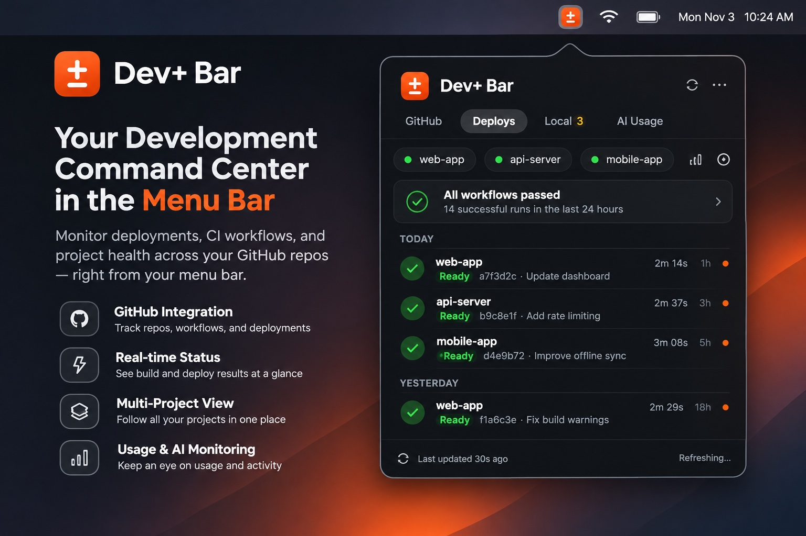
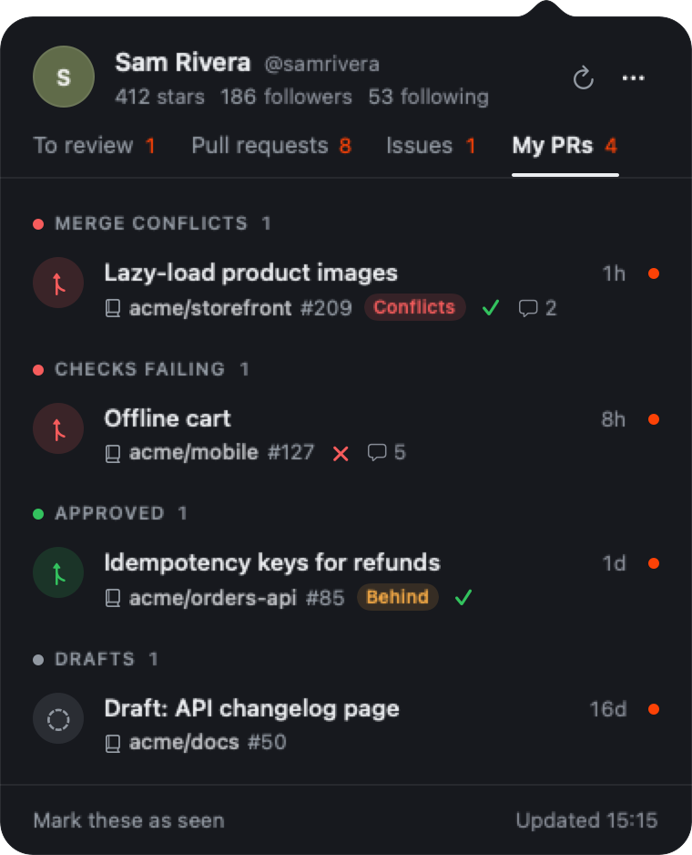
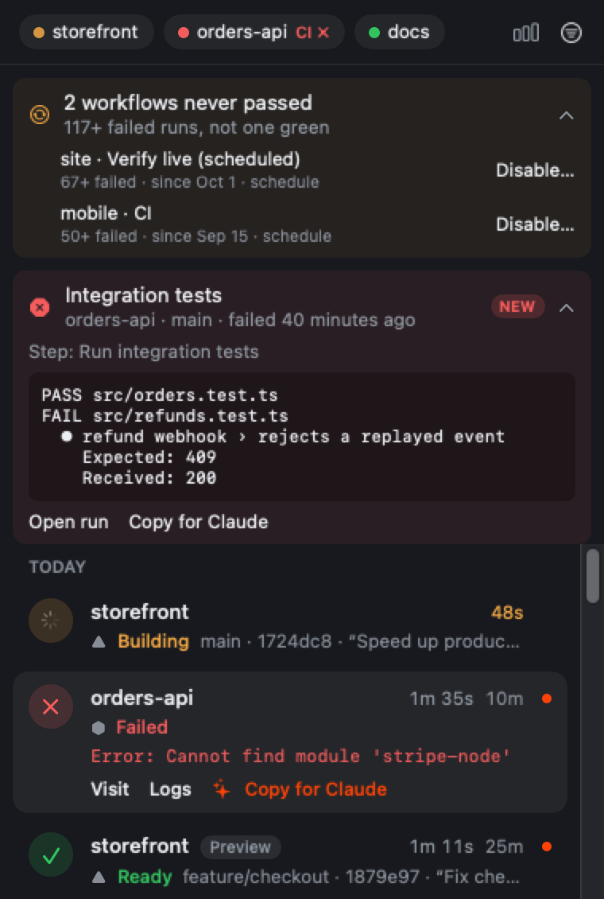
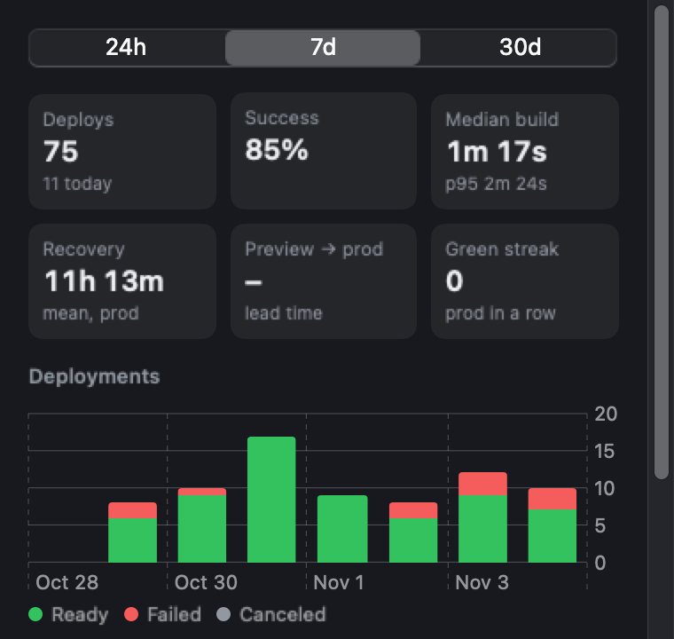
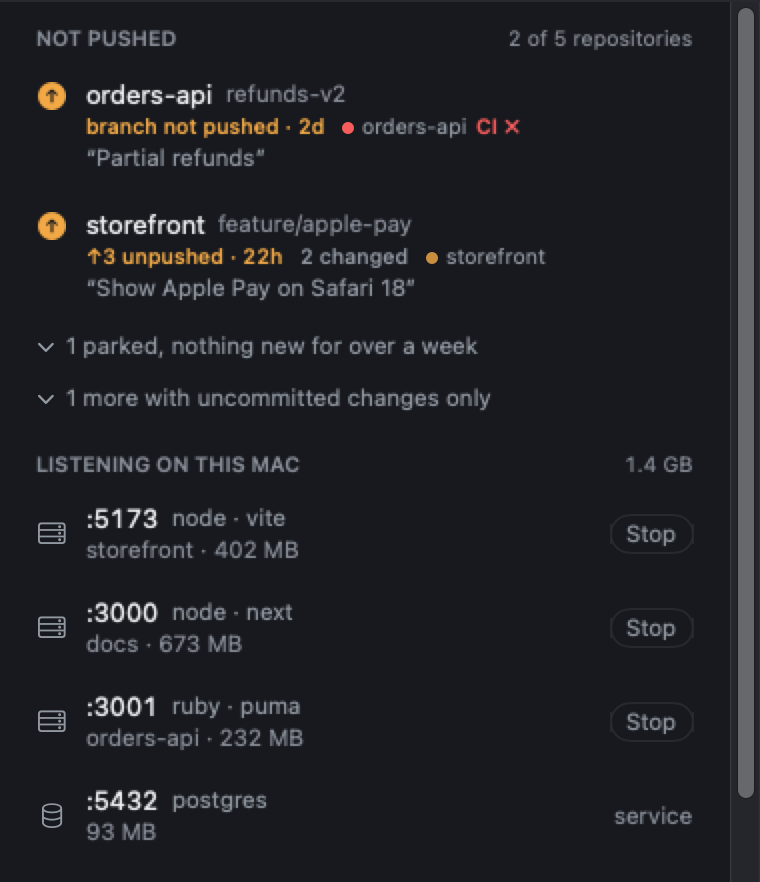
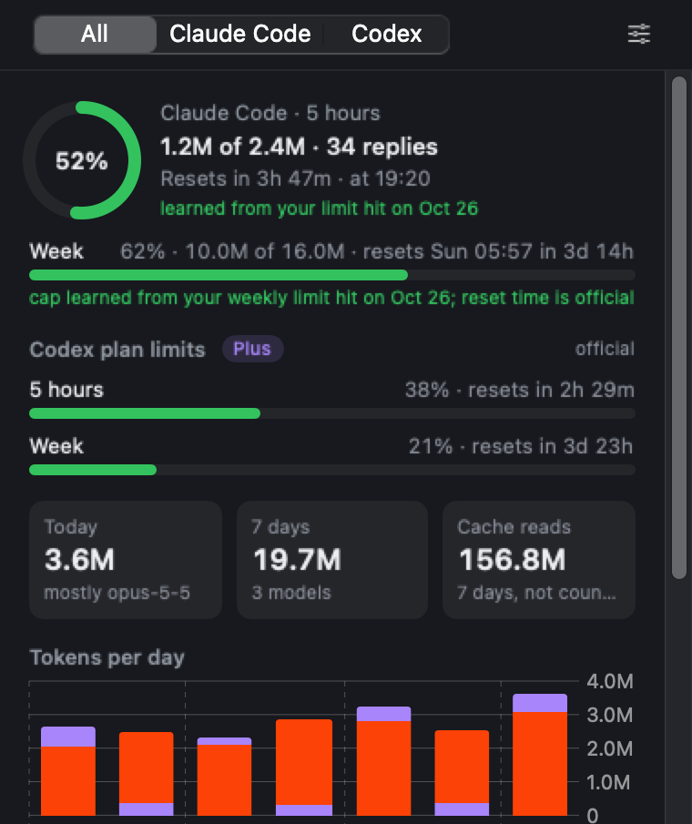

<p align="center">
  
</p>

<p align="center">
  <a href="https://github.com/therbta/devplusbar/releases/latest"></a>
  
  
</p>

<p align="center">
  <code>brew install --cask therbta/tap/devplusbar</code>
</p>

---

A lot of a developer's day goes on checking things. Is anyone waiting on my review? Did the
deploy go through? Why is CI red again? Which dev server is still holding port 3000?

Dev+ Bar answers those from the menu bar, so you don't need a browser tab for each one. It talks
to GitHub, Vercel and Heroku with your own tokens. There's no Dev+ Bar server in between.

## GitHub

<table>
  <tr>
    <td width="50%"></td>
    <td width="50%"></td>
  </tr>
  <tr>
    <td>Pull requests and issues other people opened on your repositories. Unread rows get a dot.</td>
    <td>Your own pull requests, sorted by what's blocking them: conflicts, failing checks, reviews.</td>
  </tr>
</table>

- **To review**: pull requests where someone asked for your review.
- **Pull requests** and **Issues**: what people opened on your repositories, with the author,
  checks and comment count on each row. Busy repositories fold into one line.
- **My PRs**: your open pull requests, grouped by merge conflicts, failing checks, changes
  requested and approved.
- Sign in with GitHub, or continue as the account the [GitHub CLI](https://cli.github.com) is
  already signed in to.

## Deploys

<table>
  <tr>
    <td width="50%"></td>
    <td width="50%"></td>
  </tr>
  <tr>
    <td>Each build as it happens. A failed one shows the error line from its log.</td>
    <td>A week or a month of deploys: success rate, build time, time to recover.</td>
  </tr>
</table>

Connect a Vercel token or a Heroku API key in **Settings › Deployments**. Then you get:

- A card for each deployment with a live build timer, the failing line from the build log, and
  links to the site, the logs and the pull request.
- The GitHub Actions runs on each production branch. When one fails you see the step and its
  last lines, and **Copy for Claude** puts them on your clipboard as a prompt for a coding agent.
- Workflows that have never passed even once, listed with a Disable button.
- Redeploy and roll back from a card's menu, once you turn them on. Both ask before they run.

## Local and AI usage

<table>
  <tr>
    <td width="50%"></td>
    <td width="50%"></td>
  </tr>
  <tr>
    <td>Work that's only on this Mac, and every dev server still holding a port.</td>
    <td>How much of your Claude Code and Codex limits you've used, and when they reset.</td>
  </tr>
</table>

The **Local** side lists the git repositories on your Mac with work that isn't on GitHub yet:
unpushed commits, branches that were never pushed, and how long they've been sitting there.
Below that are the processes listening on a port (Vite, Next, Astro, databases), with their
project folder and memory use. A dev server you forgot about can be stopped from there.
Dev+ Bar only runs `git status`, `lsof` and `ps` for this. It never fetches, and nothing about
your local repositories leaves the Mac.

If you use Claude Code or Codex, the **AI Usage** side reads their local session logs and
shows how much of your limit you've used. For Claude it starts from the weekly percentage Claude
Code last fetched from Anthropic (cached in `~/.claude.json`), so it reads what claude.ai reads.
It warns you at 75% and 90% of the weekly limit, and when your current pace would run out before
the reset.

## Notifications

Dev+ Bar only notifies you about things you'd act on:

- a check failing, a conflict, or a merge on one of your pull requests
- someone (not a bot) replying in a thread you're in
- a workflow on a default branch going from green to red
- a deploy failing, with per-event rules for banners, sounds and the menu-bar badge

## Keyboard

| Key | |
| --- | --- |
| <kbd>⌥</kbd> <kbd>⌘</kbd> <kbd>D</kbd> | Open the panel from anywhere |
| <kbd>↑</kbd> <kbd>↓</kbd>, <kbd>Return</kbd> | Move through rows, open one |
| <kbd>←</kbd> <kbd>→</kbd> | Switch tabs |
| <kbd>⌘</kbd> <kbd>R</kbd> | Refresh |
| <kbd>⌘</kbd> <kbd>,</kbd> | Settings |

## Install

```sh
brew install --cask therbta/tap/devplusbar
```

Or without Homebrew:

```sh
curl -fsSL https://devplusbar.pages.dev/install.sh | sh
```

You need macOS 14 or later. The app is signed with a Developer ID and notarized by Apple, so it
opens without a Gatekeeper warning.

**Update:** `brew upgrade --cask devplusbar`, or run the install command again.
**Remove:** `brew uninstall --cask devplusbar`, or quit the app and move it to the Trash.

## Privacy

Dev+ Bar talks to GitHub, and to Vercel and Heroku only if you connect them. Your tokens stay in
the macOS Keychain. There's no account, no server and no analytics.

It checks every few minutes, and every 15 seconds while something is building. If you want
updates the moment they happen, you can host the small webhook relay in [`Relay/`](Relay/README.md)
yourself.

## Build from source

```sh
git clone https://github.com/therbta/devplusbar.git
cd devplusbar
make install
```

Needs Xcode 16 or later. `make test` runs the test suite. Maintainers: the release steps are in
[docs/RELEASING.md](docs/RELEASING.md).
