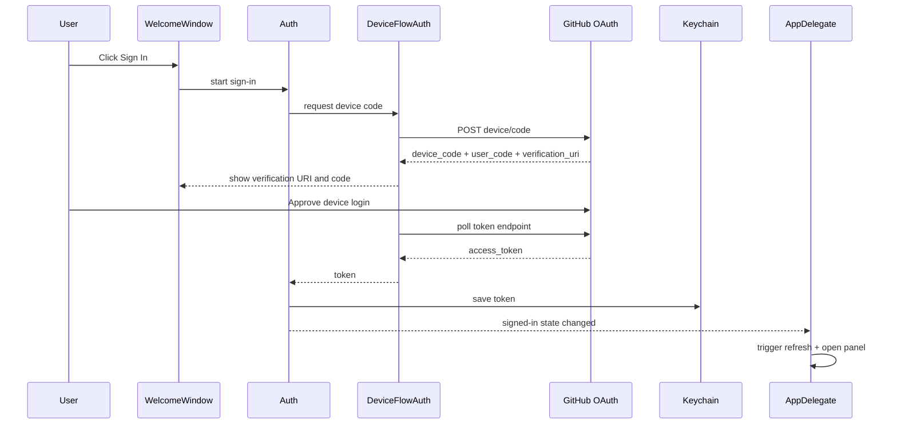
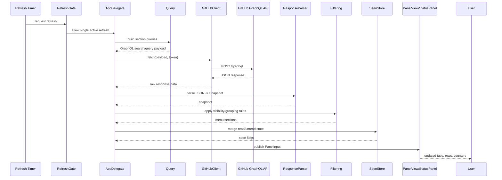

# Dev+ Bar Reverse-Engineering Map

## Top-Level Layout

- `Sources/`: main macOS app code (Swift, AppKit + SwiftUI)
- `Tests/`: unit tests for query building, parsing, filtering, auth flow, storage, and update logic
- `site`: static marketing/privacy site and assets
- `assets`: screenshots/icons used by docs/site
- `Tools`: build-time generators (`makeicon.swift`, `makeog.swift`)
- `Packaging`: release packaging metadata (MAS entitlements, Homebrew cask template)
- `docs/release-notes`: release notes used in publish flow
- `Makefile`: build, test, package, notarize, and release orchestration

## Runtime Entry Points

- `main.swift` under `Sources/`
  - Default: launches the menu bar app through `NSApplication` + `AppDelegate`
  - Hidden mode: `--render-panel <path>` renders a panel image and exits
  - Hidden mode: `--render-screens <dir>` renders App Store screenshots and exits

## Core Runtime Modules

- App lifecycle and UI shell
  - `AppDelegate.swift`: startup wiring, refresh loops, panel/toast actions, settings/welcome wiring
  - `StatusPanel.swift`: custom arrow panel attached to menu bar item
  - `PanelView.swift`: main interactive panel (tabs, rows, keyboard handling)
  - `PanelInput.swift`: panel data/state input model
  - `BarToast.swift`: compact notifications in app UI

- Auth and token handling
  - `Auth.swift`: selects auth source and sign-in state resolution
  - `DeviceFlowAuth.swift`: GitHub device-flow auth sequence
  - `TokenProvider.swift`: token lookup strategy (including CLI token path)
  - `Keychain.swift`: secure token persistence in macOS keychain

- Data fetch and transformation
  - `GitHubClient.swift`: GraphQL transport and response handling
  - `Query.swift`: query string construction for sections/tabs
  - `ResponseParser.swift`: GraphQL JSON -> app domain models
  - `Filtering.swift`: applies visibility/filter rules and section shaping
  - `Models.swift`: app domain model types

- Persistence and state
  - `Settings.swift`: user-configurable behavior flags/types
  - `SettingsStore.swift`: defaults-backed settings persistence
  - `SeenStore.swift`: tracks read/unread items
  - `RefreshGate.swift`: serializes refreshes and preserves queued intent

- UX support and system integration
  - `WelcomeWindow.swift`: sign-in/welcome surface
  - `SettingsWindow.swift`: preferences surface
  - `Notifier.swift`: local notifications integration
  - `LaunchAtLogin.swift`: startup registration on macOS
  - `UpdateChecker.swift`: release checks
  - `AuthorAvatars.swift`, `Avatar.swift`: avatar loading/cache
  - `Formatting.swift`: display-time text/date formatting helpers
  - `PanelPreview.swift`, `ScreenshotRenderer.swift`: deterministic visual render paths

## Test Coverage Map

- Auth flow: `DeviceFlowAuthTests.swift`, `TokenProviderTests.swift`, `KeychainTests.swift`
- Query + parser: `QueryTests.swift`, `ResponseParserTests.swift`, fixtures under `Tests/.../Fixtures`
- Filtering + formatting: `FilteringTests.swift`, `FormattingTests.swift`
- State + storage: `SeenStoreTests.swift`, `SettingsStoreTests.swift`, `RefreshGateTests.swift`
- Networking/update behavior: `GitHubClientTests.swift`, `UpdateCheckerTests.swift`

## Reverse-Engineering Order (Suggested)

1. Start with `main.swift` and `AppDelegate.swift` to map startup and event flow.
2. Follow refresh path: `RefreshGate.swift` -> `GitHubClient.swift` -> `Query.swift` -> `ResponseParser.swift` -> `Filtering.swift`.
3. Inspect UI state rendering in `PanelInput.swift` + `PanelView.swift` + `StatusPanel.swift`.
4. Review auth branch in `Auth.swift` + `DeviceFlowAuth.swift` + `TokenProvider.swift` + `Keychain.swift`.
5. Confirm behavior with tests and renderer modes (`--render-panel`, `--render-screens`).

## Sequence Diagram: Auth Flow

## Sequence Diagram: Refresh/Data Flow

